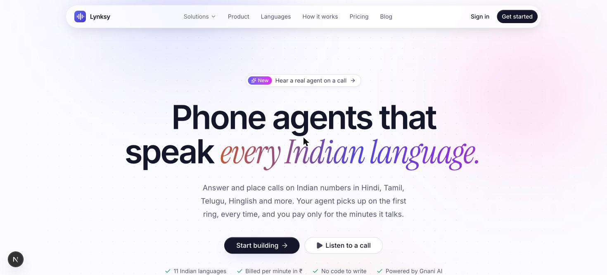
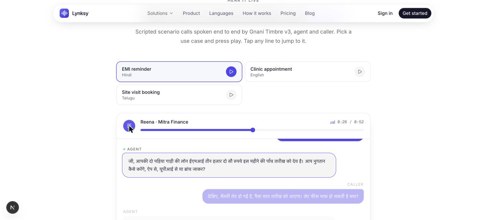
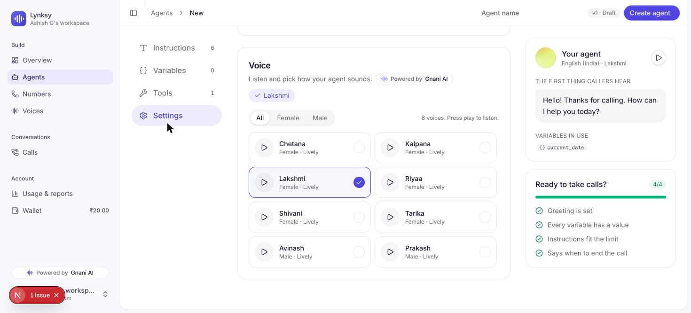
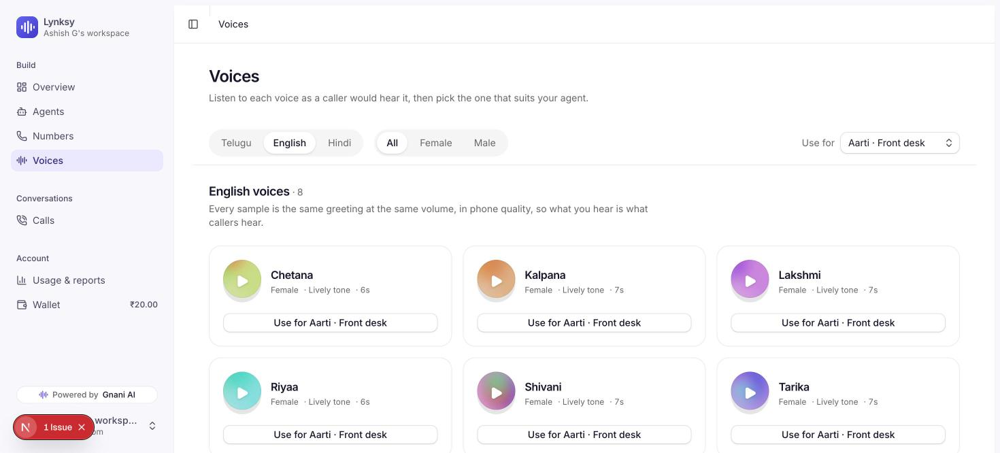

# Lynksy (AI Voice): phone agents that speak every Indian language

**Build, launch and bill AI phone agents on Indian numbers in minutes, with no code.**

**Live demo: https://app.lynksy.xyz** (sign up and use the free ₹20 test credit to try an agent).

Built for the Great Indian Internship Challenge. Gnani Timbre v3 and Gnani STT are integrated as a first-class voice provider and as the automatic failover for speech.

## The problem

Indian businesses (clinics, real-estate, lenders, restaurants, gyms) lose leads and revenue to missed calls and slow follow-ups. Voice AI tools exist, but most are built for English first. Calls in Telugu, Hindi, Hinglish or Tamil over a noisy 8 kHz phone line break them: the agent talks over the caller, reads its own reasoning aloud, repeats itself, or goes silent when one speech provider fails. Pricing in dollars and per-seat plans also don't suit small Indian businesses.

## The solution

A full-stack platform where a business owner:

1. Picks a ready-made agent template (appointments, collections, lead qualification, support) or writes a prompt, then chooses a language and voice.
2. Connects a phone number, either their own or one rented in the dashboard, or just gets a call from the agent on their phone to test it.
3. Lets the agent answer and place calls. Every call gets a transcript, an outcome summary with the details collected, and a cost breakdown.
4. Pays per minute in rupees from a prepaid wallet (Razorpay). No plans or seats.

## Screenshots

| Landing | Scenario call spoken by Gnani |
|---|---|
|  |  |
| **Agent builder: Gnani voice picker** | **Voices page** |
|  |  |

Demo video: see the submission form. The three scenario calls (Hindi, English, Telugu) are scripted in
`voice-worker/tools/make_demo_calls.py` and spoken entirely by Gnani Timbre v3.

## How a call works

```
Caller ⇄ VoiceLink (Indian DID, WebSocket media, A-law 8 kHz / 16 kHz PCM)
            ⇄ Voice worker (Python, FastAPI + Pipecat, one pipeline per call)
                 VAD + guarded barge-in → STT → LLM (OpenRouter / Sarvam) → TTS
                 STT: Sarvam or Gnani per agent, the other stands by (automatic failover)
                 TTS: Gnani / Sarvam / ElevenLabs / Smallest / Rumik per agent; Sarvam then Gnani stand by
            ⇄ Supabase (agent config by dialed number, transcripts, wallet ledger)
Next.js dashboard ⇄ Supabase (Postgres + Auth + row-level security) ⇄ Razorpay
```

## What makes it work on real Indian phone calls

- **Gnani as speech provider and safety net.** `gnani_stt.py` and `gnani_tts.py` run Gnani Timbre v3 voices and STT. If the primary provider fails mid-call, the switcher fails over to the next one so the caller never hears dead air (`tests/test_switcher_failover.py`, `test_backup_chain.py`).
- **Barge-in that survives noise.** Interruptions ignore noise loops and quieter voices of people nearby by comparing loudness against the caller's own level (`levels.py`, `turns.py`).
- **Natural speech.** The agent never reads its reasoning aloud, never repeats a sentence it already said, spells phone numbers digit by digit, and can switch to Telugu mid-call (`textfilter.py`, `bot.py`).
- **Wideband audio.** Calls run at 16 kHz when the carrier streams 16 kHz linear PCM, otherwise 8 kHz A-law.
- **Latency visibility.** Per-turn latency probes and live call levels are logged.
- **Sales and support outcomes.** After each call, a summary with collected details (name, slot, budget and so on) is stored (`outcome.py`).
- **Safe billing.** The DB enforces one wallet debit per call, and Razorpay webhooks are HMAC-verified and idempotent. Every table has row-level security keyed on org membership.
- **Test tooling.** A full-call scenario simulator (`voice-worker/tools/simulate_call.py`) runs scripted callers against an agent and records the audio and transcript.

## Stack

| Layer | Choice |
|---|---|
| Web | Next.js 16, React 19, TypeScript, Tailwind 4 |
| Data and auth | Supabase (Postgres, Auth, RLS), 4 SQL migrations |
| Payments | Razorpay prepaid wallet |
| Telephony | VoiceLink (Indian DIDs, WebSocket media streaming) |
| Voice worker | Python 3.12, FastAPI, Pipecat |
| Speech | Gnani, Sarvam, ElevenLabs, Smallest, Rumik |
| LLM | OpenRouter, Sarvam |

## Repo layout

```
web/            Next.js app: landing, pricing, blog, dashboard (agents, numbers, voices, calls, usage, wallet, WhatsApp)
  supabase/migrations/   schema and RLS
voice-worker/   Pipecat worker, provider adapters, tests, call simulator
```

## Run it

```bash
# web
cd web && cp .env.example .env.local   # fill in Supabase, Razorpay, VoiceLink values
npm install && npm run dev             # http://localhost:3000

# voice worker
cd voice-worker && cp .env.example .env   # fill in API keys (Gnani, Sarvam, OpenRouter, ...)
uv sync && uv run uvicorn main:app --port 8000
uv run pytest                              # failover, Gnani STT, variables, WhatsApp tests
```

Secrets are never committed; only `.env.example` files are tracked.

## Roadmap

More languages and voices, and bulk outbound campaigns on top of the existing outbound-call support.
